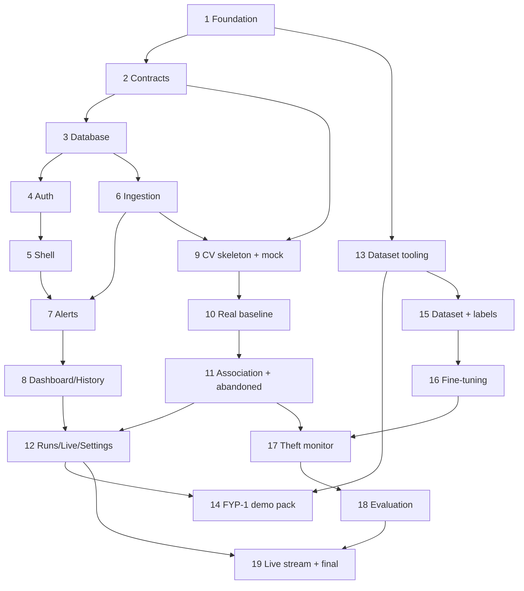

# Master Roadmap: Nigehban Campus

> End-to-end plan in 19 vertical, testable phases. Phases 1–14 are **FYP-1**. Phases 15–19 are **FYP-2**. Each phase gets a detailed `docs/phases/phase-XX.md` when it starts (template in [phases/README.md](phases/README.md)). This file defines *what* and *why*. Phase files define *how*.
>
> Baseline docs: [Context](Context.md) · [Decisions](Decisions.md) · [Architecture](Architecture.md) · [Data-Contracts](Data-Contracts.md) · [Backend](Backend.md) · [Frontend](Frontend.md) · [CV-Pipeline](CV-Pipeline.md) · [Dataset](Dataset.md) · [Folder-Structure](Folder-Structure.md)

---

## 1. Implementation rules
1. **Service boundaries:**
   - `apps/web` is UI only.
   - `apps/api` owns the DB, auth and ingestion.
   - `services/cv` owns detection and decisions, and only POSTs to the API (D-11).
2. **Contracts first:** change `Data-Contracts.md`, then `packages/contracts`, then regenerate web types, then write the code.
3. **Honest demo:** mock output is always `source: mock` and is shown as **Demo data** (D-06). No fake metrics.
4. **Video time:** detection timers use `video_ts_s`, never wall-clock time.
5. **Tooling:** Python via `uv` (workspace), web via `bun`, DB via `docker compose`.
6. **Git:** one branch per phase, `feature/phase-XX-<slug>`. Merge to `main` only after the phase's acceptance checks pass and the team approves.
7. **Definition of done (every phase):** acceptance boxes ticked, tests green, docs updated if a contract or structure changed, and the phase file's "What changed" section filled in.

---

## 2. Phases at a glance
| # | Phase | Milestone |
|---|---|---|
| 1 | Repo foundation and tooling | FYP-1 · 40% check |
| 2 | Shared contracts and type generation | FYP-1 · 40% check |
| 3 | Database schema, migrations, seed | FYP-1 · 40% check |
| 4 | Authentication (API + login screens) | FYP-1 · 40% check |
| 5 | Frontend shell (prototype port) | FYP-1 · 40% check |
| 6 | Ingestion API | FYP-1 · 40% check |
| 7 | Alerts: list, detail, actions | FYP-1 · 40% check |
| 8 | Dashboard, History, Person, polling | FYP-1 |
| 9 | CV worker skeleton and mock source | FYP-1 |
| 10 | Real baseline: pretrained YOLO26n + ByteTrack | FYP-1 |
| 11 | Geometry, association, abandoned timer | FYP-1 |
| 12 | Runs, Live view, Settings | FYP-1 |
| 13 | Dataset tooling and coverage (parallel track) | FYP-1 |
| 14 | FYP-1 hardening and demo pack | FYP-1 final |
| 15 | Dataset completion and annotation | FYP-2 |
| 16 | YOLO26n fine-tuning and evaluation | FYP-2 |
| 17 | Owner fingerprint and possible-theft monitor | FYP-2 |
| 18 | Event-level evaluation and tuning | FYP-2 |
| 19 | Live stream input and final verification | FYP-2 final |

**40% check target:** phases 1–7 done, with phases 9 and 10 started. That shows a working login → alerts flow fed by the ingest API, plus a real detection and tracking video.

---

## 3. Phases

### Phase 1: Repo foundation and tooling
**Objective:** Create the monorepo skeleton so every later phase has a place to land.
**Why:** It fixes boundaries and tooling before any logic exists.
**Scope / key files:** root `pyproject.toml` (uv workspace), `docker-compose.yml`, `.gitignore`, `.env.example`, `README.md`, empty packages for `apps/api`, `services/cv`, `packages/contracts`, a Vite app in `apps/web`, `git mv dashboard.html prototype/`.
**Tasks:**
1. Set up the uv workspace with three members, plus ruff, pytest and a Python 3.11 pin.
2. Scaffold `apps/web` with Vite React TS, Tailwind, ESLint and Prettier using bun.
3. Add `docker-compose.yml` with `postgres:16`, the `pgdata` volume and the `nigehban` DB/user.
4. Create the `data/` subfolders (git-ignored, with `.gitkeep`).
5. Write README quick-start commands.
**Verification:** `docker compose up -d` and `pg_isready` succeed. `uv sync` resolves. `bun install && bun dev` serves a placeholder.
**Acceptance:** [ ] tree matches Folder-Structure.md · [ ] all three toolchains install cleanly on a teammate's machine.
**Depends on:** none.

### Phase 2: Shared contracts and type generation
**Objective:** Implement Data-Contracts.md as Pydantic models in `packages/contracts`.
**Why:** It's the single source of truth for api and cv. D-05 depends on it.
**Key files:** `nigehban_contracts/{ids,enums,events,alerts,runs,config}.py`, `tests/`.
**Tasks:**
1. Build ID helpers (`new_id("alt")`, prefix validation) and the enums from §2.
2. Model `DetectionEvent` with type-conditional field rules, plus `RunStatusUpdate`.
3. Add the read models (`Alert`, `AlertAction`, `Run`, `Camera`, `UserMe`, `Stats`, `Page[T]`, `ErrorBody`).
4. Write the `CvConfig` model with defaults and `extra="forbid"`.
5. Add the transition table `ALLOWED_TRANSITIONS` with `can_transition(type, from, to)`.
**Contracts:** everything in Data-Contracts.md.
**Verification:** tests check that the §3 example JSON parses, bad prefixes are rejected, theft-only fields on an abandoned event are rejected, and the transition table is followed.
**Acceptance:** [ ] 100% of contract examples covered by tests · [ ] `uv run pytest packages/contracts` green.
**Depends on:** 1.

### Phase 3: Database schema, migrations, seed
**Objective:** Create the PostgreSQL tables from Backend.md §4 with Alembic, plus seed data.
**Why:** Every API feature needs persistence.
**Key files:** `apps/api/app/{core/settings.py,db/,models/}`, `alembic/`, `scripts/seed.py`, `app/main.py` with `/api/health`.
**Tasks:**
1. Write pydantic-settings config from `.env`.
2. Create SQLAlchemy models for `users`, `cameras`, `runs`, `alerts`, `alert_actions`, with check constraints and indexes.
3. Write the first Alembic migration.
4. Seed 2 users, 4 cameras (CAM 01–04, names from the prototype) and ~8 demo alerts (`is_demo=true`) with placeholder snapshots.
5. Add `GET /api/health`.
**Verification:** `alembic upgrade head` then `downgrade base` round-trips. The seed is idempotent. `/api/health` reports the DB as connected.
**Acceptance:** [ ] schema matches Backend.md · [ ] seed runs twice without duplicates.
**Depends on:** 2.

### Phase 4: Authentication
**Objective:** Operators log in and out. Routes are protected by role.
**Why:** Login is a core use case and every other screen sits behind it.
**Key files:** `app/core/security.py`, `routers/auth.py`, `features/auth/*`, `lib/api/client.ts`.
**Tasks:**
1. Hash passwords with Argon2 and issue 12 h JWTs.
2. Add `POST /api/auth/login`, `GET /api/auth/me`, and the `current_user` and `require_admin` dependencies.
3. Add the error handler for the standard error shape.
4. Build `LoginPage`, `LoggedOutPage` (matching the prototype), `useAuth` (token in memory and `localStorage`) and `RequireAuth`.
5. Generate `schema.d.ts` from OpenAPI (a `bun run gen:api` script).
**Verification:** API tests cover a wrong password (401), a protected route without a token (401) and an admin-only route as operator (403). Browser: login → shell → logout → `/logged-out`.
**Acceptance:** [ ] login/logout works end to end · [ ] generated types are used by the client.
**Depends on:** 3.

### Phase 5: Frontend shell (prototype port)
**Objective:** Reproduce the prototype's shell and design system in React.
**Why:** It gives the visual base for all screens and is the most visible progress.
**Key files:** `styles/tokens.css`, `layout/{AppShell,MobileTabBar}.tsx`, `components/*`, `app/router.tsx`.
**Tasks:**
1. Port the `:root` tokens and fonts into Tailwind theme and CSS variables.
2. Build the sidebar (nav, open-alert badge, user block), the topbar (search, bell) and the mobile bottom tabs under 760 px.
3. Build UI primitives: Card, Button, Pill (type/status), StatTile, Table, Modal, EmptyState, DemoBadge, Snapshot.
4. Add the routes from Frontend.md §3 with placeholder pages.
**Verification:** a side-by-side visual check against `prototype/dashboard.html` at 1440 px and 390 px. No horizontal scroll on mobile.
**Acceptance:** [ ] the shell matches the prototype · [ ] every route reachable · [ ] keyboard focus visible.
**Depends on:** 4.

### Phase 6: Ingestion API
**Objective:** The worker can create runs and post status, frames and events. Events become alerts.
**Why:** This is the only door from cv into the system (D-11), and both mock and real use it.
**Key files:** `routers/ingest.py`, `services/{alert_service,storage}.py`.
**Tasks:**
1. Add the `X-Worker-Key` dependency.
2. Add `POST /api/ingest/runs`, `/runs/{id}/status` and `/runs/{id}/frame`.
3. `POST /api/ingest/events`: validate with contracts, check the run is running and the camera matches, save the snapshot, create the alert with `ref_code`, derive `is_demo`.
4. Make it idempotent on `event_id`, and roll back the snapshot on DB failure.
5. Add a dev script `scripts/post_fake_event.py`.
**Verification:** tests cover a valid event (201), a resend (200 duplicate), a wrong key (401), a run not running (409), and a theft field on an abandoned event (422).
**Acceptance:** [ ] a posted event appears as an `active` alert with its snapshot · [ ] no duplicates under retry.
**Depends on:** 3 (and 2).

### Phase 7: Alerts: list, detail, actions
**Objective:** Operators see alerts, open one, acknowledge it and close it with an outcome.
**Why:** This is the core operator workflow from Context.md §4.
**Key files:** `routers/alerts.py`, `features/alerts/*`.
**Tasks:**
1. Add `GET /api/alerts` with the filters and pagination from Backend.md, plus detail, snapshot and actions.
2. Add `acknowledge` and `close`, enforced through `can_transition`, and write `alert_actions` in the same transaction.
3. Build `AlertsPage` (open alerts, status filter, search), `AlertDetailPage` (snapshot, facts, actions by type, timeline) and the DemoBadge.
**Verification:** API tests cover every allowed and disallowed transition. Browser: ingest a fake event, see it in Alerts, acknowledge it, close it as `false_alarm`, and see the timeline.
**Acceptance:** [ ] "Possible theft" wording everywhere · [ ] outcomes offered depend on type · [ ] audit row for every action.
**Depends on:** 5, 6.

### Phase 8: Dashboard, History, Person, polling
**Objective:** Complete the read-side screens and make them live with 3 s polling.
**Key files:** `routers/stats.py`, `features/{dashboard,history,person}/*`.
**Tasks:**
1. Add `GET /api/stats`.
2. Build the dashboard tiles, today's alerts and the camera preview card (placeholder until Phase 12).
3. Build History filters (type, status, range 1/7/30 days, search) with pagination.
4. Build the Person page, showing alerts for a track ID in a run.
5. Add polling per Frontend.md §4, with the new-alert toast, badge and optional sound.
**Verification:** posting a fake event makes the dashboard counters and toast update within about 3 s without a reload.
**Acceptance:** [ ] every prototype view except Live and Settings is functional on real API data.
**Depends on:** 7.

### Phase 9: CV worker skeleton and mock source
**Objective:** `nigehban-cv run --source mock` plays a scenario against a real video and feeds the API.
**Why:** It drives the whole UI end to end before the real pipeline exists (D-03, D-05).
**Key files:** `services/cv/nigehban_cv/{cli,config,pipeline}.py`, `stages/`, `mock/scenario_player.py`, `sinks/{api_sink,csv_sink,frame_pusher}.py`, `scenarios/*.json`.
**Tasks:**
1. Write the stage Protocols and config loading.
2. Build `ScenarioPlayer`: OpenCV file source, scripted events at `at_s`, and a snapshot drawn on the real frame.
3. Build `ApiSink` (retries), `CsvSink` and `FramePusher`.
4. Handle SIGTERM and failure status posting.
5. Write 3 scenarios (abandoned, possible theft, mixed) using office clips.
**Verification:** running a mock scenario gives alerts with real snapshots, shown with the Demo data badge, and `events.csv` written.
**Acceptance:** [ ] mock events are always `source: mock` · [ ] Ctrl+C leaves the run `stopped`.
**Depends on:** 2, 6. Can run in parallel with 7–8.

### Phase 10: Real baseline: pretrained YOLO26n + ByteTrack
**Objective:** Run real detection and tracking on our clips with COCO weights (D-04).
**Why:** It proves real CV work in FYP-1 and gives the baseline that fine-tuning must beat.
**Key files:** `real/{file_source,yolo_detector,bytetrack_tracker}.py`, `draw.py`, the `baseline` CLI.
**Tasks:**
1. Build the YOLO26n wrapper, filtering to person, handbag and backpack, with config-driven `conf`, `imgsz` and `device`.
2. Use Ultralytics' built-in ByteTrack, with `track_buffer` from config.
3. Draw boxes and IDs, and write `annotated.mp4` and `fps.json`.
4. Run on 5 or more clips across scenarios and save the outputs as report evidence, with a short note on weak cases (small or occluded bags).
**Verification:** `nigehban-cv baseline --video … --no-api` produces both outputs. FPS is reported for CPU and for GPU if available.
**Acceptance:** [ ] annotated videos for at least 5 clips · [ ] FPS table · [ ] observations written in phase-10.md.
**Depends on:** 9 (CLI and config). Independent of the API.

### Phase 11: Geometry, association, abandoned timer
**Objective:** Real `abandoned_bag` alerts from recorded clips.
**Key files:** `real/{geometry,associator,abandon_monitor}.py`, `tests/`.
**Tasks:**
1. Compute the foot-point-to-bag distance ratio.
2. Build the per-bag state machine (CANDIDATE → ASSOCIATED → SEPARATING → ALERTED).
3. Treat a lost owner track as "away".
4. Run the timer on `video_ts_s` and emit one alert per separation.
5. Draw owner lines and a timer overlay.
6. Make `--source real` run the full chain through `ApiSink`.
**Verification:** unit tests on synthetic track sequences (owner leaves, returns early, walks past). On ABN clips the alert fires. On NRM-SIT and NRM-RET it does not.
**Acceptance:** [ ] real abandoned alerts with `source: real` reach the dashboard · [ ] thresholds come only from `config.json`.
**Depends on:** 10.

### Phase 12: Runs, Live view, Settings
**Objective:** Operators start and stop monitoring runs from the UI, watch the live frame, and tune detection settings.
**Key files:** `routers/{runs,cameras,settings}.py`, `services/run_launcher.py`, `features/{live,settings}/*`.
**Tasks:**
1. Add `GET /api/videos` and `POST /api/runs`, which spawns the worker subprocess.
2. Add `POST /api/runs/{id}/stop`, and on startup mark runs with a dead PID as `failed`.
3. Add `GET /api/runs/{id}/frame`.
4. Build the Live page (1×1 or 2×2 tiles with a frame refresh every 1 s, run controls, status and FPS) and the dashboard camera preview.
5. Add `GET/PATCH /api/settings` and the Settings page (admin editable), plus camera create and edit.
**Verification:** starting a run from the UI shows the live frame and alerts arriving. Stop works. A changed threshold applies on the next run.
**Acceptance:** [ ] full operator flow without a terminal · [ ] video paths are restricted to `data/videos`.
**Depends on:** 8, 11.

### Phase 13: Dataset tooling and coverage (parallel track)
**Objective:** An organised, documented ~150-clip dataset with evidence of its coverage.
**Why:** It's the FYP's novelty, and the jury will judge it (D-02).
**Key files:** `dataset/manifest.csv`, `dataset/tools/{check_manifest,coverage}.py`, consent form template (kept offline).
**Tasks:**
1. Record following Dataset.md §1 and §2.
2. Fill the manifest, including `event_start_s` and `event_end_s`.
3. Write `check_manifest.py` (names, files, durations via OpenCV).
4. Write `coverage.py` (scenario, bag-class and lighting tables written to a Markdown table for the report).
**Verification:** the checker passes on the full manifest. The coverage table is close to the targets.
**Acceptance:** [ ] ~150 clips · [ ] ≥ 40% normal clips · [ ] coverage table in the report.
**Depends on:** 1. Runs alongside 2–12.

### Phase 14: FYP-1 hardening and demo pack
**Objective:** A reliable, rehearsed demo and the report material.
**Tasks:**
1. Write a `scripts/demo.ps1` reset: DB reset, seed, start services.
2. Run through every screen and fix loading, empty and error states.
3. Write an e2e smoke test: login, mock run, alert, acknowledge, close.
4. Polish the README.
5. Produce report and poster figures: architecture, baseline FPS table, annotated frames, coverage table.
6. Make sure mock content is clearly labelled in the slides.
7. Update the diagrams to the final names.
**Acceptance:** [ ] a teammate runs the demo from scratch with only the README · [ ] Context.md FYP-1 checklist ticked.
**Depends on:** 12, 13.

### Phase 15: Dataset completion and annotation (FYP-2)
**Objective:** Grow the dataset to about 500 clips and make it ready for training.
**Tasks:**
1. Record the remaining scenarios, focusing on `HARD` and elevated angles.
2. Sample frames at 1–2 fps and remove near-duplicates.
3. Label `person`, `handbag` and `backpack` (CVAT or Label Studio) and export in YOLO format.
4. Split by clip, location and actors, and fill `split` in the manifest.
**Acceptance:** [ ] labelled frames with a QA pass on 5% · [ ] no clip shared across splits.
**Depends on:** 13.

### Phase 16: YOLO26n fine-tuning and evaluation (FYP-2)
**Objective:** Fine-tune from COCO weights and show measured improvement.
**Tasks:**
1. Write a training script with config-driven hyperparameters and augmentation.
2. Train n (and s if time allows).
3. Evaluate the pretrained baseline against fine-tuned on the test split (mAP50, mAP50-95, per-class precision and recall).
4. Record FPS.
5. Version the weights outside git and point `config.detector.weights` at them.
**Acceptance:** [ ] results table baseline vs fine-tuned · [ ] the pipeline runs with the new weights unchanged.
**Depends on:** 15, 10.

### Phase 17: Owner fingerprint and possible-theft monitor (FYP-2)
**Objective:** Replace the theft mock with real logic.
**Tasks:**
1. Build `OwnerMatcher`: store several owner crops at association time and embed them with CLIP (and try a ReID model).
2. Use cosine similarity calibrated on the dataset.
3. Build `TheftMonitor`: bag displacement plus a non-owner carrier for `min_frames` while the owner is away, a match below the threshold, and exclusions (owner near, authorised or closed).
4. Handle the bag being lost during pickup.
5. Remove the mock theft from real runs.
**Acceptance:** [ ] real `possible_theft` alerts on THF clips · [ ] none on NRM-OWN or NRM-HND · [ ] CLIP vs ReID comparison recorded.
**Depends on:** 11, 16.

### Phase 18: Event-level evaluation and tuning (FYP-2)
**Objective:** Prove the system works with numbers (Context.md §7).
**Tasks:**
1. Build `evaluation/` that runs the pipeline over the test clips.
2. Match events to manifest ground truth (type plus time window).
3. Report per-type precision and recall, false alarms per hour of normal footage, alert delay and FPS.
4. Tune thresholds on val only.
5. Run an optional check on a public set (ABODA or PETS 2006).
**Acceptance:** [ ] a reproducible metrics report from one command · [ ] known limits documented.
**Depends on:** 17.

### Phase 19: Live stream input and final verification (FYP-2)
**Objective:** Run on a live camera stream and close out the project.
**Tasks:**
1. Add an RTSP or webcam `FrameSource` with a reconnect policy.
2. Run long sessions to check stability (memory, FPS drift).
3. Do a full e2e rehearsal with the final weights.
4. Finalise docs, report and demo.
**Acceptance:** [ ] a 1-hour live run without a crash · [ ] Context.md "done" definition met.
**Depends on:** 18, 12.

---

## 4. Dependency map

## 5. Deferred (beyond FYP-2 unless time allows)
Email or SMS notifications · multi-site or multi-tenant · WebSockets or SSE · cloud deployment · face blurring in snapshots · cross-camera tracking · video archive.

## 6. Open questions
1. FYP-1 final presentation date: needed to fix the Phase 14 deadline.
2. GPU availability for Phase 16: a lab machine or Colab?
3. Is "Confirmed theft" recorded only, or should it notify someone? Default: recorded only.
